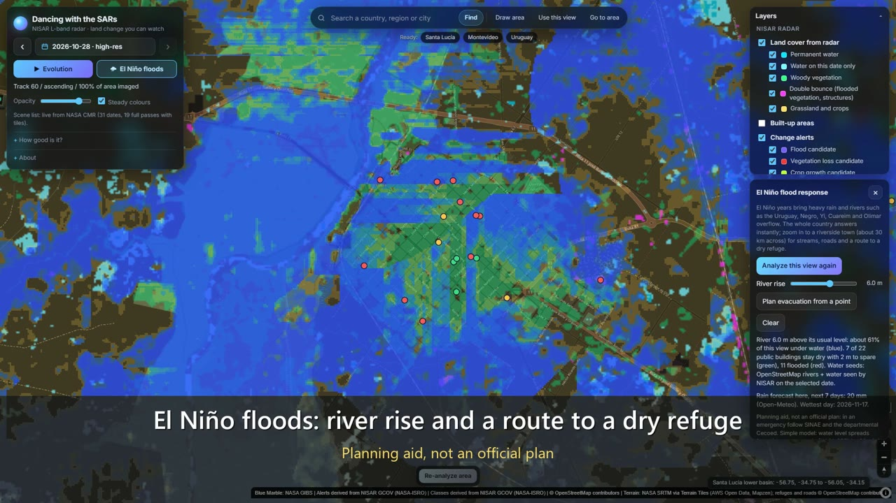
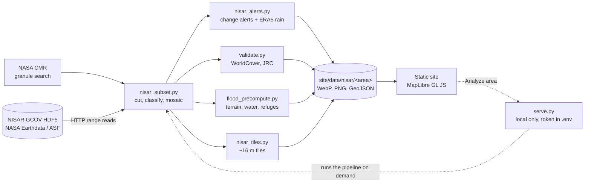

<div align="center">

# Dancing with the SARs

**Land change you can watch, from NISAR L-band radar.** Built for the NASA Space Apps Challenge 2026.

[](https://rafaelrodriguezsanz.github.io/dancing-with-the-sars/)
[](https://www.spaceappschallenge.org/2026/challenges/dancing-with-the-sars/)
[](https://asf.alaska.edu/)
<br>
[](requirements.txt)
[](site/js)
[](https://maplibre.org/)
[](#tests)
[](LICENSE)
[](#use-of-ai)

</div>

Radar-based surface-change monitor for Uruguay, with a flood-response tool for El Niño years.

Made by **Rafael Rodriguez Sanz**, Montevideo, Uruguay.

> Hackathon entry, November 14-15, 2026. Unofficial: not affiliated with or endorsed by NASA, ISRO or any space agency.

**Live demo:** https://rafaelrodriguezsanz.github.io/dancing-with-the-sars/ (GitHub Pages, no login).

**Demo video (30 s):** [watch the MP4](https://rafaelrodriguezsanz.github.io/dancing-with-the-sars/docs/demo.mp4)

[](https://rafaelrodriguezsanz.github.io/dancing-with-the-sars/docs/demo.mp4)

## At a glance

| | |
|---|---|
| **Radar data** | Real NISAR L2 GCOV passes (HH, HV), July to November 2026, cut from NASA Earthdata with HTTP range reads |
| **Ready areas** | Santa Lucía river basin (80 m, ~16 m tiles on selected dates), Montevideo, whole of Uruguay (200 m mosaic of 35 passes) |
| **Products** | Land-cover classes, change alerts (flood, vegetation loss, crop growth), built-up areas, wind at the pass, El Niño flood map |
| **Validation** | 86.5% agreement with ESA WorldCover country-wide (kappa 0.69); permanent water IoU 0.64 against JRC |
| **Runs on** | Static site on GitHub Pages; optional local server analyzes any area up to ~10° per side |

## Contents

- [The challenge](#the-challenge)
- [What it is](#what-it-is)
- [Using the app](#using-the-app)
- [How the radar products are made](#how-the-radar-products-are-made)
- [Validation](#validation)
- [Data sources](#data-sources)
- [Run locally](#run-locally)
- [Code layout](#code-layout)
- [Tests](#tests)
- [Known limitations](#known-limitations)
- [Use of AI](#use-of-ai)
- [License](#license)

## The challenge

**[Dancing with the SARs](https://www.spaceappschallenge.org/2026/challenges/dancing-with-the-sars/?tab=details)**: build an interactive application that uses radar data from the NASA-ISRO Synthetic Aperture Radar (NISAR) mission to track and visualize surface change anywhere in the world.

## What it is

An interactive globe that turns real **NISAR** L-band radar data (HH and HV backscatter, GCOV product, from NASA Earthdata / ASF DAAC) into things a person can read:

- a **land-cover map** (water, woody vegetation, open land, built-up);
- **change alerts**: flood, vegetation loss and crop growth candidates;
- **built-up areas** next to OpenStreetMap towns;
- an **animated wind map** at the hour of each radar pass (wind roughens water, which changes how it looks to the radar);
- an **El Niño flood response** tool: which ground a river rise would cover, which public buildings stay dry as refuges, and a road route that avoids flooded streets.

Radar sees through clouds and at night, which matters most during the long rainy spells El Niño brings to Uruguay, when optical satellites see only clouds. The rules that turn backscatter into classes and alerts are simple and explainable on purpose (thresholds in dB, no black-box model), so each result comes with a plain reason.

## Using the app

- **Start.** The site opens on the Santa Lucía river area with every layer on. **Ready** buttons under the search bar jump to the precomputed areas: Santa Lucía, Montevideo and the whole of Uruguay ("latest mosaic": newest valid pixel of 35 passes, ~200 m).
- **Layers** (right panel). Land-cover classes (80 m, ~16 m tiles where built), change alerts, built-up areas and **Wind at the radar pass**: moving white lines, brighter when faster (white so they never clash with the coloured layers), from the Open-Meteo historical forecast at the pass hour. Strong wind makes open water bright to the radar and can hide water or floods; a south-east wind (sudestada) piles water on the Río de la Plata coast.
- **Dates.** Step through acquisition dates with the arrows or pick one in the calendar: highlighted days have ~16 m tiles, normal days 80 m products, dashed days a NISAR pass without products here; greyed days had no pass. Or press **Evolution** to play them and chart class shares and mean backscatter over time.
- **Alerts.** Click a candidate to see its date, size, the rule that fired and, for floods, the rain of the previous 7 days.
- **Search bar (top).** Find a country, region or city by name, draw an area or use the current view, then **Analyze area** (needs the local server, see below). Progress bar and cancel included.
- **How good is it?** Agreement of the map with independent references, where computed.
- **El Niño flood response.** Press **El Niño floods** (next to Evolution) at any zoom: it opens the panel and analyzes the view. for the whole country the flood map and the public buildings are precomputed (`scripts/flood_precompute.py`) and show instantly. Zoom in to a riverside town (about 30 km across) and press **Analyze this view again** for the detailed analysis with streams and roads. Move the **River rise** slider (0-10 m) to see the flooded ground (blue), the safety margin (yellow) and the public buildings coloured by status: green stays dry, yellow is close to the water, red is flooded. Press **Plan evacuation from a point** and click where people need to leave from: the green line is the road route to the nearest dry refuge; a red dashed line shows the usual shortest way when it crosses flooded road. The panel also shows the 7-day rain forecast for the spot.
- **About.** Credits and this README.

### How the flood response works

Everything runs in the browser, from open data, with no server:

1. **Terrain** from NASA SRTM (~30 m) through the Terrain Tiles open dataset on AWS.
2. **Water seeds**: rivers, streams and lakes from OpenStreetMap, the sea, and the water NISAR sees on the selected date.
3. **Height above the nearest water** for every cell: a flood-fill spreads the water level from the seeds over the terrain (a simple HAND model). A river rise of *R* metres floods every cell less than *R* metres above its nearest water.
4. **Refuges**: schools, hospitals, clubs, community centres, town halls and other public buildings from OpenStreetMap. Safe means at least 2 m above the scenario water level.
5. **Routes**: the road network from OpenStreetMap; Dijkstra's shortest path where flooded road costs 50 times its length, so a start that is already under water still gets the shortest way out.

It is a **planning aid, not an official evacuation plan**. It ignores levees, drains, river flow and one-way streets, and OpenStreetMap buildings are not confirmed shelters. In an emergency follow [SINAE](https://www.gub.uy/sistema-nacional-emergencias/) and the departmental Cecoed.

## How the radar products are made

1. **Find** NISAR GCOV granules over the box through NASA CMR (`scripts/nisar_access.py`).
2. **Cut** the box out of each remote HDF5 granule with HTTP range reads: only the chunks covering the area are downloaded, not the ~2 GB file (`scripts/nisar_subset.py`). dB values are cached in `data/raw/` (gitignored).
3. **Classify** each pixel with rules on gamma0 in dB: water, woody (high HV), double bounce (built-up or flooded vegetation), herbaceous (the rest). Permanent water and built-up come from per-pixel medians over the time series. Wind-roughened water (e.g. the Río de la Plata off Montevideo) can look like grassland to L-band, so places that JRC Global Surface Water sees as water at least 90% of the time are added to permanent water; validation uses the radar-only mask. For the whole country, a mosaic keeps the newest valid pixel of many passes.
4. **Alert** on changes between dates (`scripts/nisar_alerts.py`). Each pass is first normalised by its own per-pixel median, so different viewing geometries can be mixed.
   - *Flood*: HH < -17 dB and HV < -23 dB, at least 3 dB darker than usual, near permanent water.
   - *Vegetation loss*: HV > -14 dB before and a lasting drop of 4 dB or more.
   - *Crop growth*: HV < -18 dB before and a lasting rise of 4 dB or more.
5. **Add context.** Flood candidates carry the 7-day rainfall before the date from Open-Meteo (ERA5) (`scripts/rainfall.py`): above 20 mm flooding is plausible, below 5 mm it is more likely dry, smooth soil.
6. **Validate** against independent maps (`scripts/validate.py`).
7. **Serve.** A static MapLibre GL site (plain ES modules, no build step) reads the products. `scripts/serve.py` adds a small localhost API that runs steps 1-6 for a drawn area.

## Validation

`scripts/validate.py` compares our map (most frequent class per pixel over 30 dates) with ESA WorldCover 2021 in four groups, and our permanent water with JRC Global Surface Water (water at least 50% of the time). Test box west of Montevideo (-56.75, -34.75 to -56.05, -34.15), 823,491 pixels at ~80 m:

| Group | Recall | Precision |
|---|---|---|
| Water | 0.71 | 0.78 |
| Woody | 0.58 | 0.74 |
| Open land (grass, crops, bare) | 0.97 | 0.93 |
| Built-up | 0.30 | 0.41 |

Overall agreement 90%, kappa 0.63. Permanent water vs JRC: IoU 0.63 (recall 0.76, precision 0.79).

Montevideo area (30 dates, ~80 m): overall agreement 76.6%, kappa 0.68; permanent water vs JRC IoU 0.83. Agreement is lower than in the rural box because the city mixes buildings, trees and lawns inside each 80 m pixel.

Whole of Uruguay (35 dates, 7,600,294 pixels at ~200 m): overall agreement 86.5%, kappa 0.69. Water recall 0.98, precision 0.71 (wind-calm wetlands and rice paddies read as water); woody 0.69 / 0.70; open land 0.89 / 0.94; built-up 0.25 / 0.19. Permanent water vs JRC: IoU 0.64 (recall 0.91, precision 0.68).

WorldCover is from 2021 and has its own errors (about 75% overall accuracy); our maps are from 2026, so some disagreement is real change. This measures agreement with another map, not accuracy against ground truth. The alerts are **not** validated against observed events.

## Data sources

| Source | Use | Licence / terms |
|---|---|---|
| **NISAR L2 GCOV** (NASA-ISRO), via [NASA Earthdata](https://search.earthdata.nasa.gov/) / [ASF DAAC](https://asf.alaska.edu/) and [CMR](https://cmr.earthdata.nasa.gov/search) | Core data: HH/HV backscatter. Some granules are provisional. Earthdata Login required. | NASA open data policy |
| [NASA GIBS](https://earthdata.nasa.gov/eosdis/science-system-description/eosdis-components/gibs) | NISAR browse tiles for comparison, Blue Marble | NASA open data |
| NASA SRTM via [Terrain Tiles on AWS](https://registry.opendata.aws/terrain-tiles/) | Terrain for the flood scenario | Public domain (SRTM); see the dataset attribution |
| [ESA WorldCover 2021 v200](https://esa-worldcover.org/) | Validation of land cover | CC BY 4.0 |
| [JRC Global Surface Water](https://global-surface-water.appspot.com/) | Validation of permanent water; fills wind-roughened permanent water | Copernicus free and open; Pekel et al. 2016, Nature |
| [Open-Meteo](https://open-meteo.com/) (ERA5 archive, historical forecast and forecast APIs) | Past rain for flood alerts, wind at the pass hour, 7-day rain forecast | CC BY 4.0; ERA5 under the Copernicus licence |
| [OpenStreetMap](https://www.openstreetmap.org/copyright) (tiles; Overpass API; Nominatim) | Basemap, towns, roads, rivers, public buildings, country search | ODbL, © OpenStreetMap contributors |
| [MapLibre GL JS](https://maplibre.org/) 5.12.0, [marked](https://marked.js.org/) 12 | Map rendering, README viewer | BSD-3-Clause, MIT |

## Run locally

Requires Python 3.12 and `make` (Node 18+ only for the tests).

1. Create a free account at https://urs.earthdata.nasa.gov, open "Generate Token" and copy the token (valid 60 days).
2. Copy `.env.example` to `.env` and set `EARTHDATA_TOKEN`. `.env` is gitignored: never commit it. Optional: `NISAR_CACHE_DAYS` (drawn areas unused for that many days are deleted, default 7) and `NISAR_WORKERS` (parallel downloads, default 4; lower it on machines with little RAM).
3. Run `make`. It creates `.venv`, installs `requirements.txt`, checks `.env` and starts `scripts/serve.py`. Open http://127.0.0.1:8000/site/
4. Draw an area and press **Analyze area**. Products go to `site/data/nisar/<area>/`; drawn areas (`aoi_*`) are gitignored.

### Analyze another country

The public site has Uruguay precomputed. Any other country or region up to 10° per side (Paraguay, Costa Rica, Portugal, a province of Argentina...) can be built on your computer:

1. Do steps 1-3 above (token in `.env`, `make`, open http://127.0.0.1:8000/site/).
2. Type the country in the search bar at the top and press **Find** (place names from OpenStreetMap Nominatim). Or draw a box.
3. Press **Analyze area**. The local server cuts the NISAR passes over the box, builds a newest-pixel mosaic (boxes wider than 1.5° are processed like a country: ~2700 px across, alerts averaged 2x2), the change alerts and the precomputed flood map (terrain, JRC water and OpenStreetMap public buildings).
4. A country takes from several minutes to an hour, depending on how many passes cover it and your connection. Results stay in `site/data/nisar/aoi_*` (gitignored) and reopen instantly.

The token never leaves your computer: it is read from `.env` by `scripts/serve.py`. The public GitHub Pages site cannot do this step, because NASA's data servers do not accept authenticated requests from a web page.

Other targets: `make install`, `make test` (unit tests with Jest), `make PORT=9000`.

Command line:

```
.venv/Scripts/python scripts/nisar_subset.py --bbox w,s,e,n --limit 12
.venv/Scripts/python scripts/nisar_alerts.py --bbox w,s,e,n
.venv/Scripts/python scripts/validate.py --bbox w,s,e,n
```

`scripts/nisar_tiles.py` builds the ~16 m tiles for chosen dates. On Linux/macOS use `.venv/bin/python`.

## Architecture



The browser code follows a clean architecture: domain rules have no browser or network code, so they are unit tested on their own.

## Code layout

- `site/js/domain`: pure rules (scenes, areas, land cover, flood height, routing). No browser or network code.
- `site/js/application`: use cases (scene lists, evolution series, validation summary).
- `site/js/infrastructure`: NASA CMR, Overpass, terrain tiles, Open-Meteo, the local processing API.
- `site/js/presentation`: map, panels and controls. `site/js/main.js` wires everything.
- `scripts/`: Python pipeline and local server.

## Tests

```
make test        # or: npm install && npm test
```

Unit tests cover every layer of the browser code: domain rules (areas, footprints, land cover, flood height, routing), use cases (evolution series, validation summary), infrastructure parsers and map layers. They live in `tests/`, one folder per layer, and run with [Jest](https://jestjs.io/) (Node 18+). The site itself still needs no build or install; Jest is only a development dependency.

## Known limitations

- Alerts are **candidates** from simple rules, not confirmed events. Very dry, smooth bare soil can look like water to radar.
- The flood scenario is a bathtub model on 30 m terrain: no river flow, levees or drains. Use it to see where to look first, not as a forecast.
- ERA5 rain and the wind layer are weather-model values (~10-25 km), not gauge or station data; context only.
- NISAR data in use is partly provisional and may change.
- The country mosaic mixes passes from different dates and geometries, so seams between strips are visible. Uruguay-wide alerts use a 400 m grid, so small changes only show in the 80 m areas.
- **Built-up is weak** (recall 0.30, precision 0.41): towns full of trees look like woody vegetation at 80 m. OpenStreetMap towns are shown alongside for that reason.
- Analyzing a new area or country needs a personal Earthdata token and the local server (see *Analyze another country*); the public site only shows Uruguay.
- The country-wide flood map uses ~130 m terrain and only rivers wider than ~30 m (JRC) as water, so ground next to small streams looks higher than it is; zoom in for the detailed analysis.

## Use of AI

The code, tests and documentation were written with the help of Claude (Anthropic, via Claude Code) under the author's direction. The author chose the idea, the challenge and the approach, and reviewed the results. AI-assisted commits carry `Co-Authored-By` trailers. No NASA logos or branding are used or implied.

## Author

Rafael Rodriguez Sanz, Montevideo, Uruguay. Solo entry for the NASA Space Apps Challenge 2026.

## License

Code under the [MIT License](LICENSE). Data keep their own licenses (see [Data sources](#data-sources)): NISAR and other NASA data are open, ESA WorldCover is CC BY 4.0 and OpenStreetMap data is ODbL.
